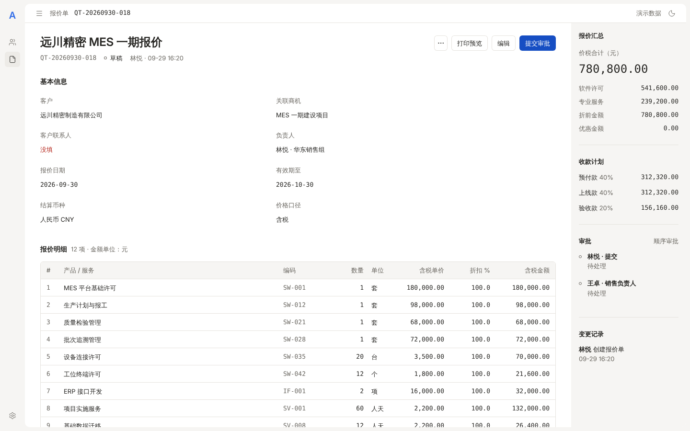
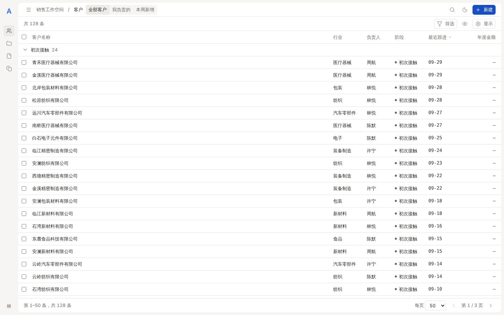
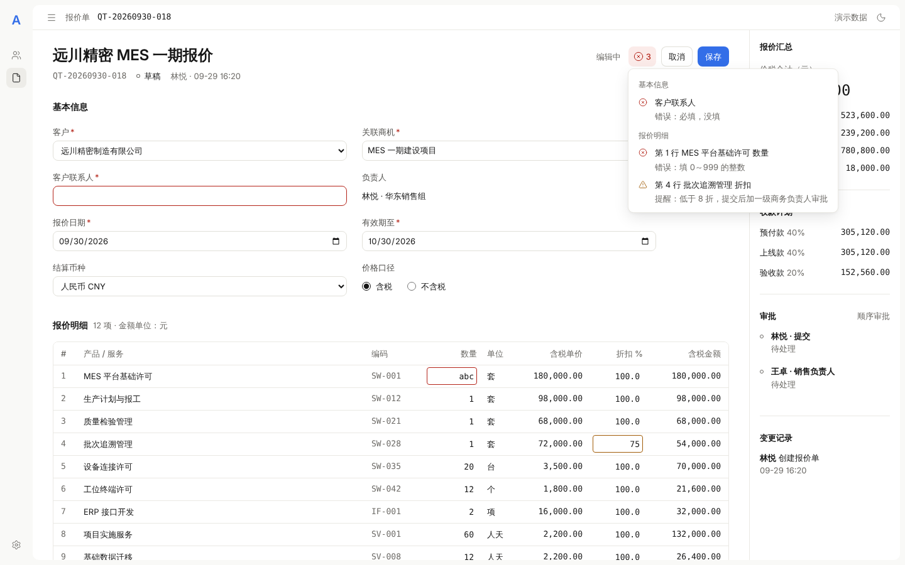
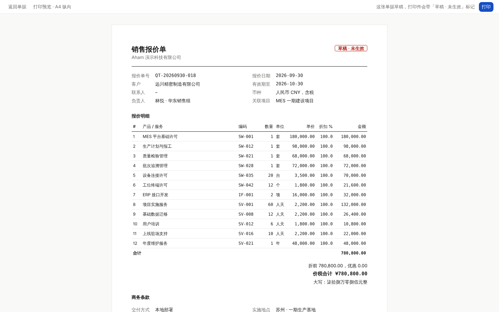
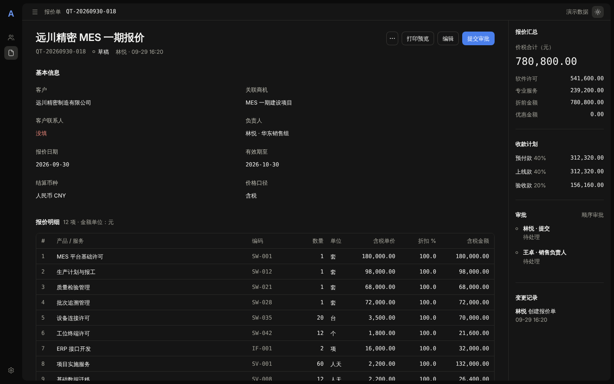

# Aham UI · 业务管理系统界面规范

[](https://github.com/Aham-AIAPP/aham-ui/releases)
[](LICENSE)
[](https://aham-aiapp.github.io/aham-ui/)
[](assets/wechat-qr.png)

Aham UI 是一套给电脑浏览器里的业务管理系统用的界面规范，也覆盖这类系统发给外部人员填写的对外填报页，包括设计理念、取值、规则、样式、脚本和示例页。AI 和人按同一份文件生成界面，同一个需求生成几次，取值和交互都一致。

总体标准一句话：**界面退到业务对象后面，让人看清现在的状态和下一步，然后用最少的操作做完。** 16 条原则和冲突时的取舍次序见 [设计理念.md](设计理念.md)，AI 和人都先读这一篇。



## 界面特征

- **视觉**：内容区纯白，侧栏比内容区深一档。灰底只用在一行高的元素上，例如按钮、输入框、选中行。分隔线 1px 暖灰，输入框和开关的描边对白底 3:1，按钮不画描边，靠底色识别。控件圆角 8px，弹窗圆角 12px。图标 14px，描边在 24 网格里是 1.75。
- **字号**：正文 14px，辅助信息 12px，一屏只用这两档；20px 标题一页一次，24px 只给金额汇总和关键信息的数。编号和金额用 Inter 的等宽数字。
- **颜色**：主色钢蓝 `#336EE8` 只用于主按钮、焦点和当前项标记，正文链接用正文色加下划线。4 个状态色表达状态，6 个分类色区分类别、头像和文件类型。需要读的文字一律不低于 4.5:1。整套中性色可以由底色、主色和对比度三个值生成。
- **密度**：列表一行一个对象，不显示表头，按分组排列，行高 44px。数据表格行高 36px，紧凑 32px，控件 32px。
- **按钮**：一个页面只有一个主按钮。一个按钮只用文字或只用图标。
- **单据**：显示态和编辑态用同一版式。单据头有关键信息和锚点栏。编辑态的取消和保存在页脚工具栏，草稿每 20 秒自动保存，离开时选择保存、保留草稿或放弃草稿。
- **列表**：筛选、视图另存、批量编辑、批量处理的结果弹窗、导出 CSV。
- **键盘**：命令面板、快捷键、右键菜单、列表键盘，全部操作都能用键盘完成。
- **取舍**：每个元素先答谁在什么时候用，答不上来就删除。记录类信息折叠在页尾，有流程的页面开头写清在等谁。
- **数据格式**：日期写 2026-10-17，金额写 780,800.00。空值按类型写：文字「未填写」、选项「未选择」、人员「未指定」、数值和日期「–」。

## 目录

| 位置 | 内容 |
|---|---|
| [设计理念.md](设计理念.md) | 总体标准、16 条原则、冲突时的取舍次序、借鉴来源 |
| [tokens.json](tokens.json) | 全部取值：亮色、暗色、增强对比度三套颜色，字号、间距、尺寸、断点 |
| [rules/](rules/) | 规则正文，十一个文件：总则、视觉、控件、页面、单据、反馈、键盘与命令、AI 协作、验收、数据格式、交互 |
| [components/](components/) | 契约，写明每个控件和组合的结构、类名、状态、键盘和调用写法；[schema.json](components/schema.json) 规定契约的字段 |
| [src/](src/) | 样式源文件，一个组件族一个文件，按编号拼接；状态和响应式写在组件自己的文件里 |
| [js/](js/) | 行为源文件，一个功能一个文件，按编号拼接 |
| [aham.css](aham.css)、[aham.js](aham.js) | 由 `scripts/build.mjs` 生成，页面只引这两个文件，不手改 |
| [aham.d.ts](aham.d.ts) | aham.js 的类型声明 |
| [examples/](examples/) | 示例页，数据全部虚构；侧栏写在 `_rail.html`，生成时复制进各页 |
| [assets/](assets/) | Inter 字体（SIL OFL）、Lucide 图标 55 个（ISC）、截图 |
| [scripts/](scripts/)、[tests/](tests/) | 生成、检查和测试脚本 |
| [docs/](docs/) | [React 接入](docs/react.md)；[docs/research/](docs/research/) 调研记录；[docs/decisions/](docs/decisions/) 已完成或作废的计划，只作历史参考 |
| [AGENTS.md](AGENTS.md) | 给 AI 的读取顺序和硬约束 |

## 示例页

| 页面 | 演示内容 |
|---|---|
| [单据页](examples/document.html) | 报价单的关键信息、锚点栏、显示态、编辑态、页脚保存、草稿和离开弹窗、添加明细行、校验、提交、审批、退回、作废、删除 |
| [打印预览](examples/print.html) | A4 版式、未生效标记、金额大写 |
| [列表页](examples/list.html) | 筛选、视图和另存、显示选项、分组、批量编辑、批量删除的结果、导出、列表键盘 |
| [工作清单](examples/worklist.html) | 待审批的报价单，行内通过和退回，批量通过 |
| [记录详情页](examples/record.html) | 属性栏、折叠的动态、带附件的评论、AI 摘要 |
| [对外填报页](examples/form.html) | 单栏居中、分段进度、附件跟随问题、手机宽度 |
| [设置页](examples/settings.html) | 分区设置、立即生效、危险操作 |
| [控件总览](examples/controls.html) | 按钮、输入框、选择控件、状态、标签、提示条、人员、阶段条、时间线、下一步提示条、数字行、折叠、单行展开 |
| [外框](examples/shell.html) | 侧栏、页眉、侧面板 |
| 部件 | [筛选](examples/parts-filter.html) · [列表键盘和详情](examples/parts-detail.html) · [快速操作](examples/parts-actions.html) · [AI 协作](examples/parts-ai.html) · [文件与版本](examples/parts-files.html) |

<table>
<tr>
<td width="50%"><br><sub>列表页</sub></td>
<td width="50%"><br><sub>单据编辑态：字段错误和消息列表</sub></td>
</tr>
<tr>
<td width="50%"><br><sub>打印预览</sub></td>
<td width="50%"><br><sub>暗色</sub></td>
</tr>
</table>

## 使用方法

**交给 AI**：把仓库地址 `https://github.com/Aham-AIAPP/aham-ui` 发给 AI，要求按 [AGENTS.md](AGENTS.md) 生成界面。

**在页面里引用**：复制 `aham.css`、`aham.js`、`aham.d.ts` 和 `assets/` 目录；用 npm 的项目可以按标签安装：`npm install github:Aham-AIAPP/aham-ui#v10.0.2`，再 `import 'aham-ui/aham.css'`。React 的接法见 [docs/react.md](docs/react.md)。

```html
<link rel="stylesheet" href="aham.css">
<div class="aham-workbench" data-theme="light">…</div>
<script type="module">
  import { initShell } from './aham.js';
</script>
```

**换品牌**：改 tokens.json 里的取值，运行 `node scripts/build.mjs` 重新生成 aham.css。规则文件不用改。

**本地预览和检查**：

```bash
python3 -m http.server 8765 --bind 127.0.0.1   # 打开 http://127.0.0.1:8765/
npm run build                                   # 生成 aham.css、aham.js 和示例页侧栏
npm run check                                   # 生成检查、lint、契约检查、主题检查和测试
```

## 版本

当前版本 10.1.0。10.0 正文改为 14px、图标 16px，记录详情页的关键信息、阶段条、工作记录按管理系统重新打磨，并新增宽屏规则，正文字号变了，升级前先看 CHANGELOG。9.2 新增记录详情页首屏的五个组件：关键信息、带事件的阶段条、工作记录、还缺什么、处理面板。9.0 新增《设计理念》，整体风格借鉴 Linear：220px 文字侧栏、无表头的分组单行列表、铺满的主区加属性栏、两档字号、14px 图标、描边标签、阶段图标、三值生成主题。类名和变量有改动，升级说明见 [CHANGELOG.md](CHANGELOG.md)。

[Releases](https://github.com/Aham-AIAPP/aham-ui/releases) · [CHANGELOG](CHANGELOG.md) · [CONTRIBUTING](CONTRIBUTING.md) · [ORIGIN](ORIGIN.md) · [MIT](LICENSE)

## 关于 Aham

Aham 这个名字来自 *aha moment*，每个工具处理一类任务。

| 应用 | 说明 |
|---|---|
| **Aham UI**（本仓库） | 业务管理系统界面规范 |
| [Aham Word](https://github.com/Aham-AIAPP/aham-word) | AI 按规范生成 .docx 文档 |
| [Aham PPT](https://github.com/Aham-AIAPP/aham-ppt) | 把素材做成方案级 PPT 的技能 |
| Aham Excel | Excel 规范，开发中 |
| [Aham Voice](https://github.com/Aham-AIAPP/aham-voice) | 录音转写与会议纪要（macOS），本地离线转写 |
| [Aham Survey](https://github.com/Aham-AIAPP/aham-survey) | 现场调研工具（macOS），本地优先 |

公众号发布 AI 工具的实践记录和更新，扫码可以加作者微信交流。

<p></p>

## 组件与交互回归

运行 `npm run lab` 后打开 `/qa/lab.html`，体验深浅色按钮、首次失败与重试、菜单、弹窗和 AI 采纳。`/qa/browser.html` 可在浏览器里运行可控延迟和错误注入回归。

完整检查：`npm ci`、`npm run check`、`npx playwright install --with-deps chromium webkit`、`npm run test:browser`。浏览器检查结果放在 `qa-results/`，CI 作为 14 天有效的构件保存。运行时没有新增依赖。

异步回调中，确认、选择、属性保存、AI 采纳和撤销以 `void` / `true` 表示成功，`false` / reject 表示失败；新建和评论沿用必须返回 `true` 的约定。数据提交应在回调成功前完成。组件只能保护界面，服务端写入仍由产品实现幂等与事务。AI 确认的 `canUndo` 默认 `false`，只有实现了真实撤销流程时才设为 `true`。
